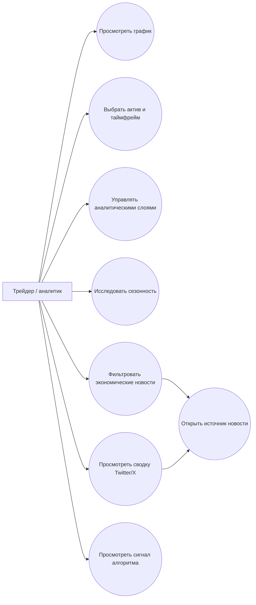
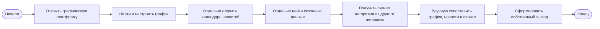
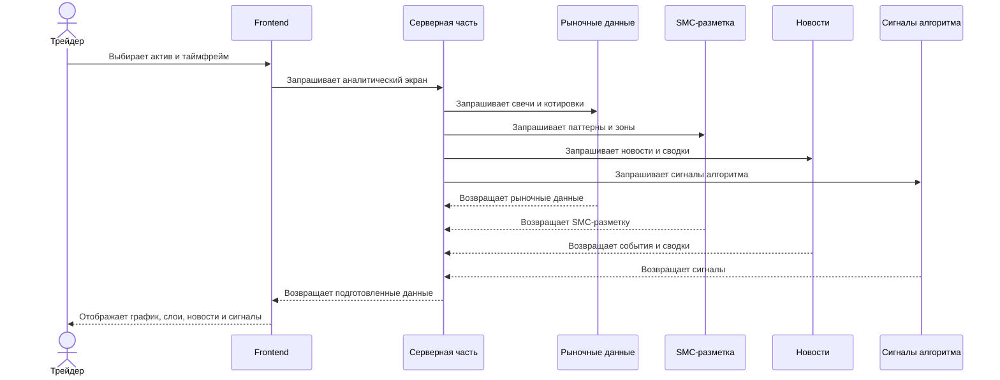
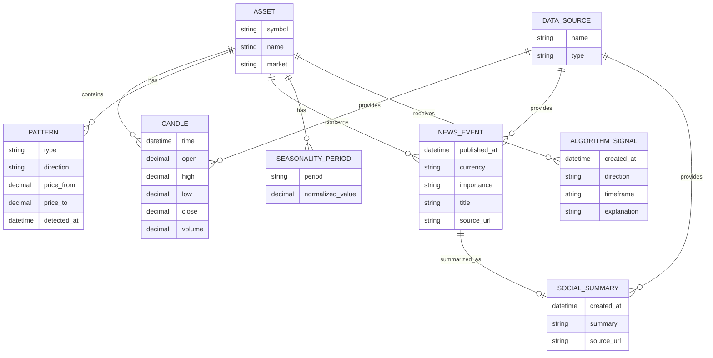
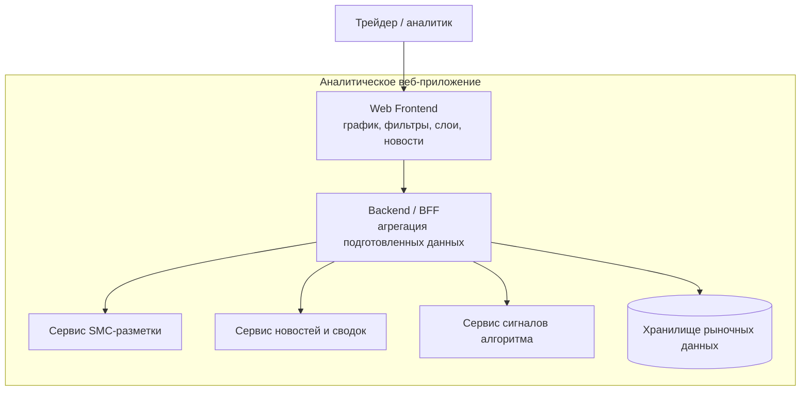

# ЛР 3 — проектирование

**Тема ВКР:** разработка клиентской части веб-приложения для визуализации торговых паттернов концепции «умных денег», сезонности рынка, экономических новостей и сигналов автоматизированного торгового алгоритма.

**Автор:** Васильев Артём.

**Вклад автора:** проектирование frontend-части: пользовательские сценарии, интерактивный график, визуализация SMC-паттернов, сезонности, новостей и сигналов алгоритма. Детектирование паттернов, ML-компоненты и серверные сервисы выполняются другими участниками команды.

**Связанный отчёт ЛР 2:** [обоснование актуальности ВКР](https://github.com/frizyyu/vkr-project/blob/artem-vasilev/docs/students/artem-vasilev/lab2/report.md).

> Диаграммы в этом отчёте представлены в формате Mermaid. Такой формат позволяет хранить исходники моделей рядом с текстом, просматривать их непосредственно в GitHub и при необходимости экспортировать в SVG/PNG.

## 1. Предметная область и требования

### Описание предметной области

Проект представляет собой веб-приложение для исследовательского анализа финансового рынка. Основные инструменты первой версии — `XAUUSD`, `EURUSD` и `GBPUSD`; в дальнейшем список активов может быть расширен.

Пользователь выбирает актив и таймфрейм, после чего изучает свечной график и дополнительные аналитические слои: зоны ликвидности, Fair Value Gaps, Order Blocks, BOS/CHoCH и другие паттерны Smart Money Concept. Отдельные разделы приложения предназначены для анализа сезонности и экономических новостей. Сигналы автоматизированного алгоритма отображаются как вспомогательная информация и не приводят к автоматическому открытию или закрытию сделок.

Система решает проблему разрозненного анализа: без единого интерфейса пользователю приходится переключаться между графическим терминалом, календарём новостей, историческими данными о сезонности и результатами алгоритма. Frontend должен связывать эти данные понятным способом, не подменяя профессиональное решение пользователя и не обещая прибыльность сигналов.

### Функциональные требования

| ID | Требование | Как проверить выполнение |
|---|---|---|
| FR-01 | Пользователь может выбрать финансовый инструмент и таймфрейм. | В интерфейсе доступны выбор актива и таймфрейма; после выбора загружается соответствующий график. |
| FR-02 | Система отображает интерактивный свечной график. | Пользователь может масштабировать, прокручивать график и выбирать отображаемый период. |
| FR-03 | Система отображает SMC-паттерны и зоны анализа на графике. | При включении слоя на графике появляются согласованные командой зоны ликвидности, FVG, Order Blocks и другие паттерны. |
| FR-04 | Пользователь может включать и выключать отдельные аналитические слои. | Переключение слоя изменяет график без потери выбранного актива и периода. |
| FR-05 | Система отображает сезонность выбранного инструмента. | Пользователь может сравнить исторические периоды и увидеть сезонные закономерности. |
| FR-06 | Пользователь может просматривать и фильтровать экономические новости. | Новости фильтруются по дате, валюте/активу и важности; открывается информация о событии. |
| FR-07 | Система отображает краткие сводки значимых публикаций из Twitter/X и других социальных источников. | Для сводки отображаются тема, время, краткое содержание и ссылка на исходную публикацию. |
| FR-08 | Система отображает сигнал автоматизированного алгоритма. | Сигнал содержит направление, актив, таймфрейм, время формирования и доступный поясняющий контекст. |
| FR-09 | Система показывает состояния загрузки, отсутствие данных и ошибки. | Для соответствующих сценариев отображаются skeleton/loading, empty state и сообщение об ошибке с возможностью повторить запрос. |

### Нефункциональные требования

| ID | Требование | Как проверить выполнение |
|---|---|---|
| NFR-01 | Интерфейс должен быть адаптивным. | Основные сценарии работают на desktop и мобильной ширине экрана без потери ключевой функциональности. |
| NFR-02 | Визуальные обозначения аналитических слоёв должны быть различимыми и непротиворечивыми. | Для паттернов, новостей и сигналов используются согласованные легенда, цвета и подписи. |
| NFR-03 | Интерфейс должен обеспечивать приемлемую отзывчивость при переключении актива, периода и слоёв. | Переключение не приводит к зависанию интерфейса; состояние загрузки явно отображается. |
| NFR-04 | Система не должна раскрывать закрытые данные пользователя и секреты. | В интерфейсе и открытом клиентском коде отсутствуют ключи брокеров, токены и пароли. |
| NFR-05 | Решение должно быть расширяемым для новых активов, паттернов и источников данных. | Добавление нового аналитического слоя не требует переписывать существующие пользовательские сценарии. |
| NFR-06 | Сигнал алгоритма должен быть представлен как вспомогательная аналитическая информация. | В интерфейсе явно указано время/контекст сигнала; автоматическое исполнение сделки отсутствует. |

## 2. Обзор нотаций и видов диаграмм

| Нотация или вид диаграммы | Что описывает | Сильные стороны |
|---|---|---|
| BPMN | Бизнес-процессы, события, действия, развилки и роли. | Хорошо показывает текущий и целевой пользовательский процесс AS-IS/TO-BE. |
| IDEF0 | Функции системы, входы, выходы, управления и механизмы. | Удобна для функциональной декомпозиции сложной системы. |
| IDEF3 | Последовательность действий и сценарии выполнения процесса. | Позволяет фиксировать порядок операций и альтернативные пути. |
| ER-модель | Сущности, атрибуты и связи между данными. | Подходит для описания рыночных данных, паттернов, новостей и сигналов. |
| DFD | Потоки данных между процессами, хранилищами и внешними сущностями. | Показывает, какие данные передаются между frontend и командными сервисами. |
| UML | Поведение и структура программной системы. | Объединяет Use Case, Sequence, Component и другие виды диаграмм. |
| C4-модель | Контекст системы, контейнеры и компоненты архитектуры. | Понятно показывает границы frontend, backend, ML и внешних сервисов. |
| ArchiMate | Архитектуру организации, приложений, технологий и их связи. | Подходит для крупной корпоративной архитектуры, но избыточна для текущего учебного прототипа. |
| DMN | Правила принятия решений и таблицы решений. | Может использоваться для формализации правил классификации сигналов, но в первой версии не является основной нотацией. |
| EPC | События и функции бизнес-процесса. | Подходит для процессного описания, но менее удобна для архитектуры веб-приложения. |

## 3. Выбор нотаций для проекта

Для проектирования выбраны четыре нотации/семейства моделей:

1. **BPMN** — описание пользовательского процесса анализа рынка и моделей AS-IS/TO-BE. Связана с `FR-01`–`FR-08` и показывает улучшение целевого процесса.
2. **UML** — Use Case, Sequence и Component. Используется для пользовательских сценариев, последовательности загрузки данных и взаимодействия frontend с командными сервисами. Связана с `FR-01`–`FR-09` и `NFR-03`–`NFR-06`.
3. **ER-модель** — описание сущностей и связей рыночных данных, паттернов, новостей, сезонности и сигналов. Связана с `FR-03`, `FR-05`–`FR-08`.
4. **C4-модель** — описание контекста и контейнеров системы. Показывает границы frontend-части и командных backend/ML-сервисов. Связана с `NFR-04`–`NFR-06`.

## 4. Модели системы

### 4.1 UML Use Case — пользовательские сценарии

Диаграмма отражает основного пользователя и ключевые пользовательские сценарии. Она покрывает выбор данных, визуальный анализ и просмотр контекстной информации. Исполнение сделок в сценарий не включено, поскольку оно не входит в первую версию проекта.

### 4.2 BPMN-представление AS-IS — текущий процесс

AS-IS характеризуется несколькими инструментами, ручным сопоставлением информации и риском потери временного или предметного контекста.

### 4.3 BPMN-представление TO-BE — целевой процесс

```mermaid
flowchart LR
    A([Начало]) --> B[Открыть аналитическое веб-приложение]
    B --> C[Выбрать актив и таймфрейм]
    C --> D[Загрузить график и аналитические слои]
    D --> E[Включить SMC-разметку и сезонность]
    E --> F[Отфильтровать экономические новости]
    F --> G[Просмотреть сводку информационного фона]
    G --> H[Сопоставить сигнал с графиком и контекстом]
    H --> I[Принять решение о дальнейшем анализе]
    I --> J([Конец])
```

TO-BE сокращает количество переходов между инструментами и связывает данные в одном пользовательском сценарии. Приложение ускоряет первичную оценку ситуации, но не заменяет профессиональное решение трейдера.

### 4.4 UML Sequence — загрузка аналитического экрана

Диаграмма показывает, что frontend отвечает за пользовательское взаимодействие и визуальное представление, а подготовка рыночных данных, паттернов, новостей и сигналов выполняется серверными компонентами команды.

### 4.5 ER-модель — основные данные

ER-модель фиксирует минимальные сущности, которые нужны frontend для отображения данных. Она не является окончательной схемой базы данных и не описывает внутренние таблицы backend-сервисов.

### 4.6 C4-представление — контейнеры системы

Frontend является основной зоной ответственности автора. Остальные контейнеры показаны для объяснения границ взаимодействия и не означают, что их реализация входит в данную ВКР.

## 5. AS-IS и TO-BE

**Выбранная нотация:** BPMN-представление процесса.

### AS-IS — текущее состояние

Пользователь использует несколько разрозненных инструментов: отдельный график, календарь новостей, источники сезонных данных и канал получения алгоритмических сигналов. Информация сопоставляется вручную, поэтому анализ занимает больше времени и зависит от внимательности пользователя.

### TO-BE — предлагаемое состояние

Пользователь работает в одном веб-приложении, где выбирает актив и таймфрейм, включает аналитические слои, просматривает сезонность, фильтрует новости и сопоставляет сигнал с рыночным контекстом. Данные остаются разделёнными по функциональным разделам, но доступны из единого пользовательского сценария.

### Обоснование перехода

Переход обеспечивается следующими решениями:

- единый выбор актива и таймфрейма для связанных разделов;
- интерактивный график с включаемыми аналитическими слоями;
- фильтрация новостей по дате, валюте/активу и важности;
- отображение времени формирования паттерна, новости и сигнала;
- единые состояния загрузки, отсутствия данных и ошибки;
- адаптивный frontend для desktop и мобильных экранов.

## 6. Выводы

В ходе проектирования выбраны BPMN, UML, ER-модель и C4-модель. BPMN показывает изменение пользовательского процесса от разрозненного анализа к единому сценарию. UML описывает действия пользователя, последовательность получения данных и взаимодействие компонентов. ER-модель фиксирует минимальный состав сущностей, необходимых для визуализации. C4-модель показывает границы frontend и серверных подсистем команды.

Сформулированные модели связаны с функциональными требованиями: выбор актива, график, SMC-разметка, сезонность, новости, сводки и сигналы отражены в пользовательских и поведенческих моделях. Нефункциональные требования отражены в архитектурном разделении, обработке ошибок, адаптивности и ограничении доступа к закрытым данным.

TO-BE улучшает AS-IS за счёт сокращения количества разрозненных инструментов и ручных переходов. При этом система не принимает торговое решение за пользователя и не выполняет автоматическое открытие или закрытие сделок в первой версии. Этап проектирования подтвердил согласованность пользовательского процесса, данных и взаимодействия frontend с командными backend/ML-компонентами.
