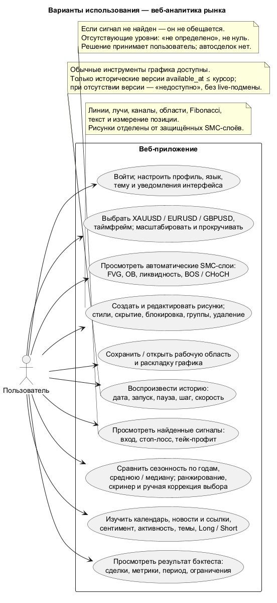
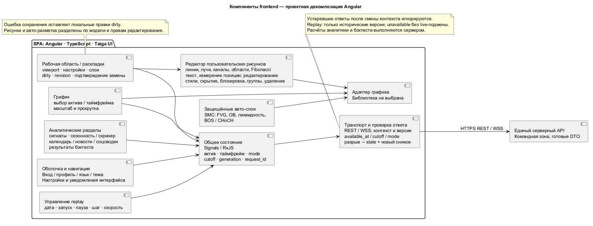
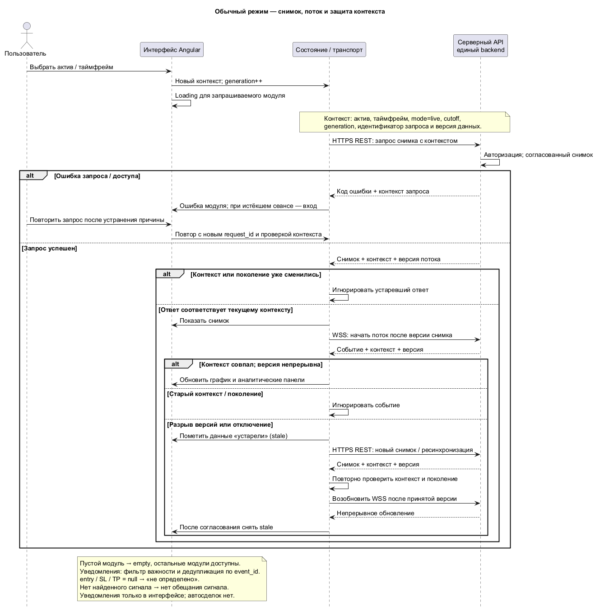
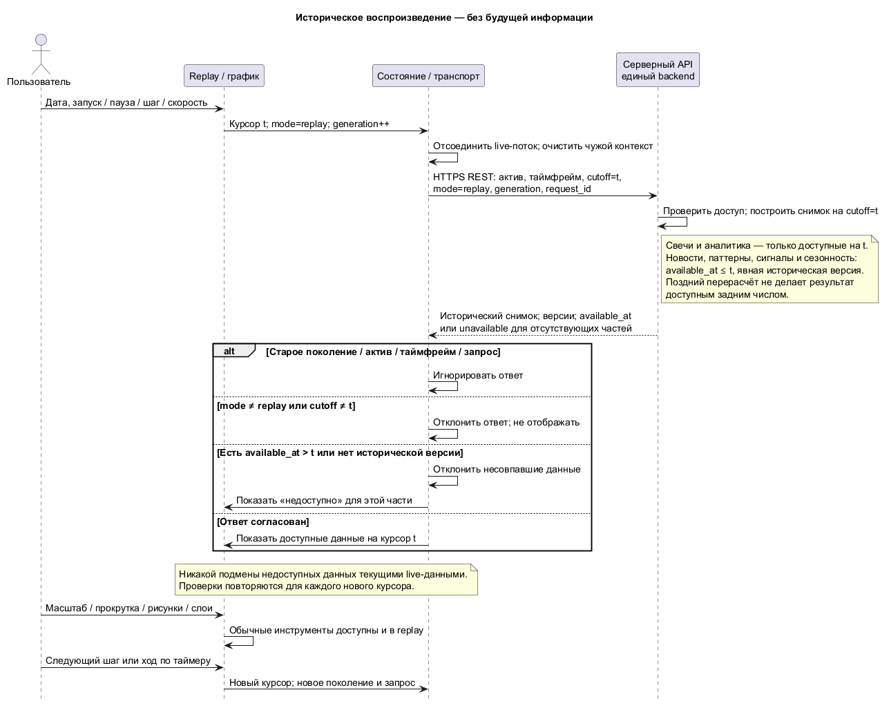
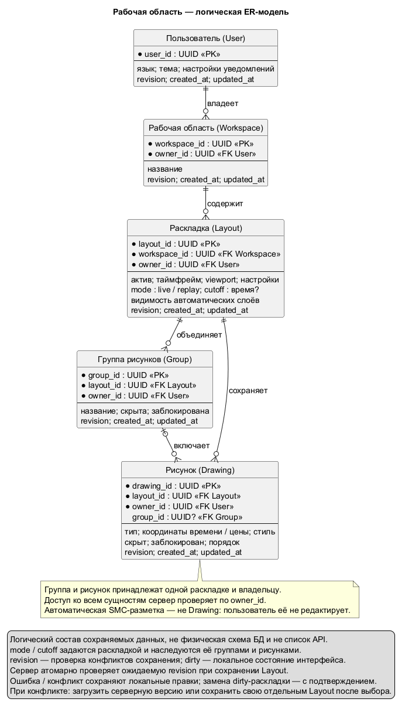
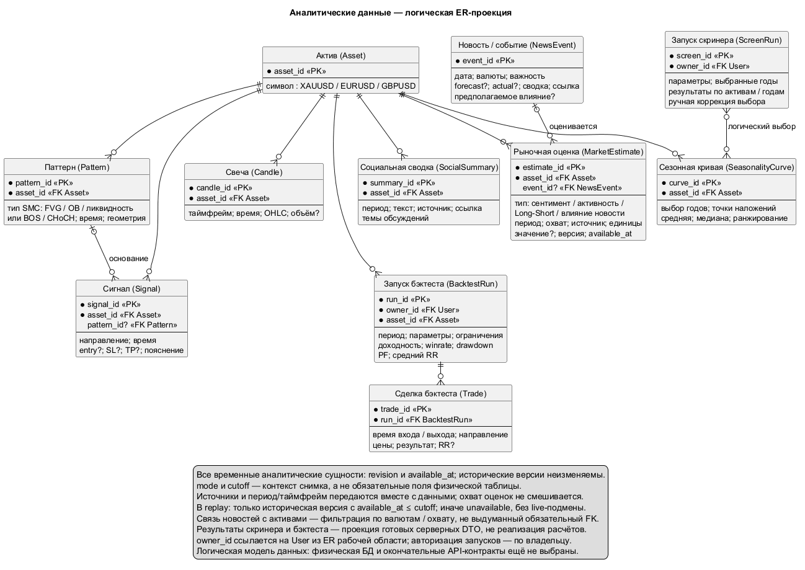
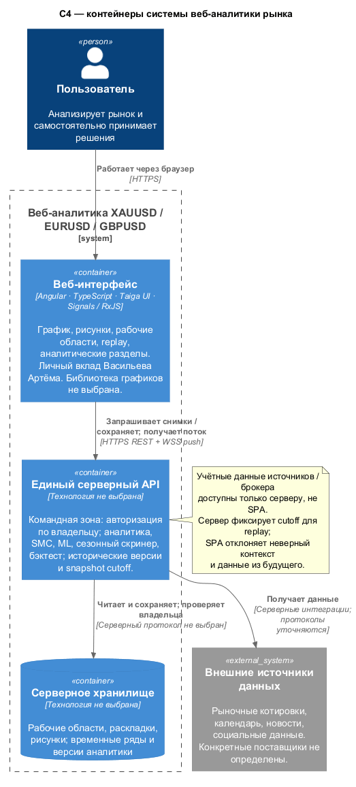
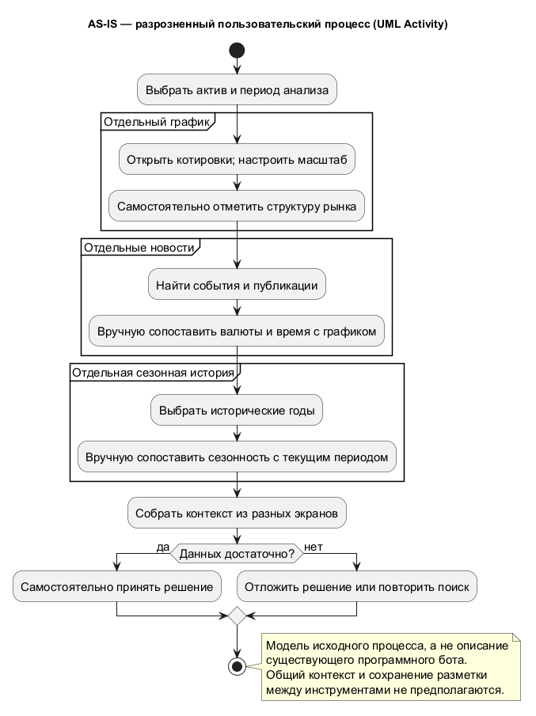
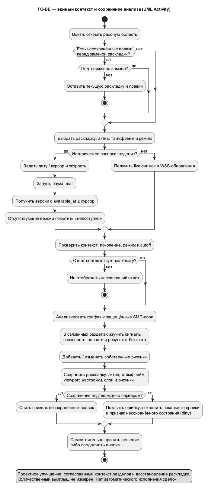

# ЛР 3 — проектирование

**Тема ВКР:** разработка клиентской части веб-приложения для визуализации торговых паттернов концепции «умных денег», сезонности рынка, экономических новостей и сигналов автоматизированного торгового алгоритма.

**Автор:** Васильев Артём.

**Вклад автора:** проектирование интерфейса, навигации и дизайн-системы; frontend графика, рисунков, рабочих пространств, Replay, сезонности, новостей и результатов алгоритма. Получение данных, детектирование SMC, обучение моделей, расчёт сезонного скринера и бэктестирование относятся к работе команды. Автор проектирует получение и представление их результатов, а не присваивает себе их реализацию.

**Основание:** [условия](https://docs.google.com/document/d/1eUcNd1wMwoVaSu-DSS-cVRgLJvTT6vza/edit), [шаблон](https://github.com/LISA-ITMO/vkr-template-main/blob/main/docs/design/report.md), [порядок сдачи](https://github.com/LISA-ITMO/vkr-template-main/blob/main/course/lab3.md), [ЛР 2](https://github.com/frizyyu/vkr-project/blob/artem-vasilev/docs/students/artem-vasilev/lab2/report.md). Объём уточнён по авторскому перечню «Задачи frontend дипломный проект» и согласованным требованиям: рисунки, Layouts, Replay и сезонный скринер обязательны; сентимент, Long/Short и оценки влияния новостей предоставляет команда.

> Это проектное решение, а не отчёт о готовом приложении. Критерии ниже — план приёмки будущей реализации. Числовые пороги являются предложенными проектными целями, а не результатами измерений. Диаграммы доступны как PNG и редактируемые исходники PlantUML в [assets](assets/).

## 1. Предметная область и требования

### Описание предметной области

Основной пользователь — трейдер/аналитик, который сопоставляет цену, SMC-разметку, сезонность и информационный фон. Основные инструменты — `XAUUSD`, `EURUSD`, `GBPUSD`. При разрозненном анализе приходится собирать сведения в разных сервисах и вручную сверять актив, период и время. Приложение связывает эти действия общей навигацией и явно показанным контекстом.

Основной модуль — интерактивный график с полученной автоматической разметкой, пользовательскими рисунками, настройками и Layouts. Replay позволяет повторять анализ по мере появления исторических свечей. Результаты серверного бэктеста представлены отдельно: ручное воспроизведение само по себе не является расчётом эффективности стратегии.

График, сезонность, новости и результаты алгоритма могут находиться на разных экранах. Связность означает согласованные актив, режим и время, а не обязательное наложение всей информации на одну шкалу. При переходе сохраняется применимый контекст; неподдерживаемый разделом фильтр обозначается явно.

Приложение не исполняет реальные сделки. Вход, Stop Loss и Take Profit показываются, если соответствующие уровни действительно найдены алгоритмом. Отсутствующие значения интерфейс не придумывает и не заменяет нулём. Предполагаемое влияние новости и настроения рынка — оценки с источником и временем, не гарантия движения цены или прибыльности.

В личный объём входят самостоятельный дизайн в Figma, структура страниц, дизайн-система, адаптивные макеты и прототипы. ЛР 3 задаёт требования и проектные решения; наличие готовых макетов всех экранов и реализованного приложения здесь не заявляется.

### Функциональные требования

FR-01–FR-09 уточняют предыдущую редакцию; дополнительные возможности описаны в FR-10–FR-18.

| ID | Требование | Как проверить после реализации |
|---|---|---|
| FR-01 | Выбор актива, таймфрейма и периода графика с отображением контекста. | Переключить три основных актива и два поддерживаемых таймфрейма; заголовок и данные соответствуют последнему выбору. |
| FR-02 | Свечной график с масштабированием, прокруткой и live-обновлениями. | Обновление изменяет соответствующую свечу без дубля времени; при разрыве потока данные отмечены как устаревшие. |
| FR-03 | Автоматическая SMC-разметка: ликвидность, FVG, Order Blocks, BOS/CHoCH. | Типы показаны по своим времени/ценам и отличимы от рисунков; результат детектора нельзя редактировать как рисунок. FVG является элементом SMC. |
| FR-04 | Видимость слоёв и рисунков; для рисунков — блокировка, группировка и удаление. | Блокировка запрещает перемещение; скрытие группы действует на её объекты; удаление рисунков не удаляет серверную разметку. |
| FR-05 | Сезонность: выбор годов/периода, наложение кривых, средняя, медиана и доступная статистика. | Изменить набор годов и сверить легенду/кривые; недостаточная история обозначена, а не заменена нулём. |
| FR-06 | Экономический календарь: время, валюта, важность, прогноз/факт; фильтры даты, валюты/актива и важности. | Проверить сочетания фильтров; до публикации факта поле пустое с обозначением; часовой пояс подписан. |
| FR-07 | Финансовые новости и аналитические сводки, включая Twitter/X, с исходными ссылками и временем. | Для сводки доступны текст, время и источник; отсутствие анализа не мешает открыть оригинал. |
| FR-08 | Сигнал: актив, направление, таймфрейм, время, пояснение и найденные entry/SL/TP. | Полный сигнал показывает уровни; частичный — «не определено» для отсутствующих. В обоих случаях нет команды реального исполнения сделки. |
| FR-09 | Состояния загрузки, отсутствия данных, ошибки и повторного запроса отдельно для модулей. | Ошибка новостей не скрывает график; повтор относится к ошибочному модулю, ответ старого актива не заменяет новый экран. |
| FR-10 | Создание/редактирование рисунков: линии, лучи, каналы, области, Fibonacci, текст и измерение позиции. | Для каждого типа создать, изменить координаты/стили, переместить и удалить; измерение позиции не создаёт торговый приказ. |
| FR-11 | Настройка свечей, шкал, фона и отображаемых элементов графика. | Настройки применяются без удаления рисунков и изменения их ценовых/временных координат. |
| FR-12 | Сохранение/восстановление Layouts: контекст, настройки, слои и рисунки. | Восстановить состояние после повторного входа; ошибка записи сохраняет локальные правки; замена несохранённого состояния требует подтверждения. |
| FR-13 | Replay: дата, запуск, пауза, шаг и скорость; доступны рисунки/настройки и согласованный исторический контекст. | Две скорости, пауза, шаг и рисунок; новости, паттерны, сигналы и сезонность не используют сведения позже курсора. Нет исторической версии — показана недоступность. |
| FR-14 | Результаты серверного бэктеста: период, сделки, доходность, win rate, просадка, profit factor, среднее отношение риска к прибыли. | Представление соответствует серверному результату; показаны условия/период, неопределённые метрики не заменены выдуманными числами. |
| FR-15 | Сезонный скринер: ранжирование годов от backend, ручная коррекция набора и повторное сравнение. | Изменить предложенный набор и сравнить кривые; ручной выбор не выдаётся за новое автоматическое ранжирование. |
| FR-16 | Влияние новости, сентимент, активность/темы обсуждений и Long/Short по данным backend. | Видны охват/инструмент, период, источник, время и единицы; несовместимые выборки не складываются в общий процент. |
| FR-17 | Главная страница и навигация, регистрация/вход, профиль, язык, тема и предпочтения. | Основные разделы доступны из навигации; вход/выход меняет доступ к личным Layouts, настройки восстанавливаются для пользователя. |
| FR-18 | Настройка и показ уведомлений о важных экономических событиях внутри приложения. | Отключение и фильтр важности меняют показ; повтор одного события не дублирует уведомление. |

### Нефункциональные требования

Контрольные условия производительности: согласованный стенд с записанными браузером и аппаратной конфигурацией; 10 000 свечей, 200 автоматических объектов, 100 рисунков. Пороги — исходные цели прототипа, которые предстоит измерить, а не уже достигнутые показатели.

| ID | Требование | Критерий проверки после реализации |
|---|---|---|
| NFR-01 | Адаптивность и доступность основных действий. | На ширинах 390, 768 и 1440 CSS px управление/навигация не обрезаны; для таблиц допустима локальная прокрутка. Кнопки, формы и диалоги доступны с клавиатуры, фокус видим. |
| NFR-02 | Единые понятные обозначения. | В дизайн-системе определены состояния; направление/статус различимы не только цветом, но подписью или формой. Легенда разделяет SMC, рисунки и оценки; контраст текстов не ниже 4,5:1. |
| NFR-03 | Отзывчивость интерфейса. | На контрольном объёме p95 изменения локальной видимости слоя не более 200 мс на 30 переключениях; при ожидании сетевого ответа loading появляется не позднее 200 мс. Время backend измеряется отдельно. |
| NFR-04 | Разграничение доступа и защита данных. | Гостю и пользователю B недоступен личный Layout пользователя A; backend проверяет владельца при каждом запросе. На клиенте нет брокерских ключей/серверных секретов. Истечение сеанса требует повторного входа для личных операций. |
| NFR-05 | Разделение вычислений и визуализации, изоляция библиотеки графика. | Другие страницы не зависят от API графической библиотеки; расчёт сигналов/скринера не дублируется на клиенте. Добавление слоя не меняет протокол Replay и модель личных Layouts. Проверка зависимостей и интеграционный сценарий. |
| NFR-06 | Согласованность контекста и актуальность. | При перестановке ответов отображается только последний контекст; версия не откатывается. Разрыв потока/пропуск включает stale-состояние до получения согласованного снимка. |
| NFR-07 | Запрет будущих сведений в Replay. | Каждый видимый объект имеет `available_at <= replay_cursor`; свечи и версии аналитики ограничены историческим снимком. Поздняя публикация, пересмотр факта и перерасчёт не появляются заранее; live не подставляется вместо отсутствующей истории. |
| NFR-08 | Сохранность пользовательских правок. | Ошибка записи оставляет Layout dirty и редактируемым; конфликт ревизии не перезаписывает новую серверную версию молча. Замена несохранённого состояния требует предупреждения. |

## 2. Обзор нотаций и видов диаграмм

| Нотация или вид | Что описывает | Сильные стороны |
|---|---|---|
| BPMN | События, задачи и взаимодействие участников процесса. | Подробное описание бизнес-процессов и обмена сообщениями. |
| IDEF0 | Функции, входы/выходы, управление и механизмы. | Функциональная декомпозиция и ответственность. |
| IDEF3 | Сценарии процесса и изменения состояний. | Порядок действий и альтернативные пути. |
| ER | Сущности, ключи, атрибуты и кратности. | Целостность данных и основание модели хранения. |
| DFD | Потоки, процессы, хранилища и внешние сущности. | Источники и преобразования информации. |
| UML Use Case | Акторы, границы и цели пользователя. | Отделение возможностей от реализации. |
| UML Activity | Действия, условия, потоки управления. | AS-IS/TO-BE и альтернативные сценарии. |
| UML Sequence | Сообщения участников во времени. | Асинхронность, ошибки, порядок ответов. |
| UML Component | Компоненты и зависимости. | Границы модулей и точек интеграции. |
| C4 | Контекст, контейнеры, компоненты, код. | Обязанности приложений/хранилищ и технологии связей. |
| ArchiMate | Бизнес-, прикладные и технологические слои. | Связь организационных целей с инфраструктурой. |
| DMN | Решения, зависимости и таблицы правил. | Проверяемые правила без смешения с процессом. |

Условие допускает обзор нотаций и/или видов диаграмм. Виды UML перечислены отдельно в обзоре, но при выборе ниже считаются одним семейством, а не четырьмя независимыми нотациями.

## 3. Выбор нотаций для проекта

Выбраны **три семейства: UML, ER и C4**. BPMN рассмотрена, но не используется: UML Activity достаточно для пользовательского процесса. AS-IS/TO-BE выполнены в одной нотации; обычные блок-схемы не названы BPMN.

| Семейство | Что моделируем | Требования | Почему подходит |
|---|---|---|---|
| UML: Use Case, Activity, Sequence, Component | Цели, AS-IS/TO-BE, live/Replay, frontend-модули. | FR-01–FR-18; NFR-01–NFR-03, NFR-05–NFR-08. | Связывает действия с модулями, порядком сообщений и ошибками. |
| ER, «воронья лапка» | Layouts, рисунки и владелец; логические данные аналитики. | FR-03–FR-08, FR-10–FR-17; NFR-04, NFR-07, NFR-08. | Явные ключи, связи, ревизии и временная доступность. |
| C4, контейнеры | Пользователь, SPA, backend, хранилище и внешние источники. | FR-02, FR-09, FR-12–FR-17; NFR-04–NFR-08. | Границы ответственности, протоколы и серверные проверки. |

## 4. Модели системы

### 4.1. UML Use Case — пользовательские возможности



[Исходник](assets/use-case.puml).

**Модель:** график, рисунки, Layouts, Replay, сезонность/скринер, новости/оценки, сигналы, результаты бэктеста и личные настройки находятся внутри границы приложения. Backend — часть реализации, не второй пользователь. Реальное исполнение сделки отсутствует.

**FR:** FR-01–FR-18 задают цели пользователя. **NFR:** ограничения доступа и сохранности уточнены в ER и C4; овалы вариантов использования сами по себе безопасность не доказывают.

### 4.2. UML Component — frontend



[Исходник](assets/frontend-components.puml).

**Модель:** оболочка объединяет маршруты, главную, навигацию, профиль и личные настройки. Графический модуль содержит адаптер графика, редактор рисунков, настройки и управление слоями. Общее состояние содержит актив, таймфрейм, live/Replay и исторический курсор. Разделы сезонности, новостей и бэктеста получают применимый контекст, сохраняя собственные фильтры. Транспорт отделён от визуальных компонентов; сохранение Layout не пересчитывает сигналы.

**Технологии:** Angular, TypeScript, Taiga UI, Signals/RxJS, SCSS/CSS Variables; Figma для дизайн-системы. Для аналитических графиков предполагается Apache ECharts. Финансовая библиотека не утверждена: OpenAlgo Charts и KLineChart — кандидаты для прототипирования рисунков, Replay, слоёв и нагрузки. Адаптер не означает, что замена библиотеки бесплатна, но локализует зависимость.

**FR:** FR-01–FR-18 распределены между модулями. **NFR:** NFR-01/02 — общие компоненты и состояния, NFR-03 — локальная видимость без запроса всей аналитики, NFR-05 — адаптер и серверные вычисления. Доступность и быстродействие проверяются после реализации, а не следуют автоматически из выбора Angular.

### 4.3. UML Sequence — live-загрузка и обновления



[Исходник](assets/sequence-live.puml).

**Модель:** новый выбор создаёт поколение загрузки. Начальный снимок получается по HTTPS REST, поток обновлений — по WSS. Контекст включает актив, таймфрейм, режим и поколение; устаревший ответ не применяется после смены выбора. Версия/номер обновления позволяет обнаружить дубль и пропуск. Точные API-поля/endpoint предстоит согласовать: схема задаёт семантику, не выдаёт проектный формат за существующий контракт.

При разрыве потока показаны последнее успешное обновление и stale-состояние, затем запрашивается новый снимок. Ошибка локализована в модуле, доступен повтор. В Replay live-обновления не применяются к историческому экрану. Уведомления учитывают настройки и идентификатор события для устранения дублей; live-уведомления не подмешиваются в исторический контекст.

**FR:** FR-01–FR-09, FR-16, FR-18. **NFR:** NFR-03, NFR-06 — загрузка и согласованность; NFR-04 — ошибки доступа обрабатываются без обхода авторизации. Для журналирования достаточно идентификатора запроса, режима и кода ошибки, без паролей и секретов сессии.

### 4.4. UML Sequence — Replay



[Исходник](assets/sequence-replay.puml).

**Модель:** при переходе в Replay прекращается применение live-потока. Backend получает актив, таймфрейм и исторический курсор. Пауза сохраняет курсор; шаг и скорость управляют его продвижением. Рисунки и настройки остаются доступны.

`event_time` — время события, `available_at` — момент доступности сведений. Backend возвращает согласованный снимок: свечи и версии паттернов, новостей, сигналов и оценок, доступные на момент курсора. Поздно опубликованная новость не появляется заранее; пересмотренный факт не заменяет старое значение задним числом. Сезонность и скринер также ограничиваются доступной историей, без будущих наблюдений и последующих перерасчётов.

Frontend проверяет режим, контекст и границу снимка; неподходящие данные отбрасываются. Нет исторической версии — слой недоступен, а не заменён live. Фильтра только по времени свечи недостаточно: это общая обязанность клиента и сервера. Возврат в live требует нового актуального снимка.

**FR:** FR-02–FR-08, FR-10/11, FR-13, FR-15/16. **NFR:** NFR-06/07 — согласованность и отсутствие будущих сведений. FR-14 относится к отдельному серверному бэктесту со своими условиями, не к автоматическому открытию сделок в Replay.

### 4.5. ER — рабочие пространства



[Исходник](assets/er-workspace.puml).

**Модель:** пользователь владеет Workspace, Layout описывает сохранённое состояние, Drawing — личный рисунок, группа объединяет рисунки того же Layout. Координаты объектов привязаны ко времени и цене, а не только к пикселям. В Layout сохраняются контекст, настройки и видимость автоматической разметки, но паттерны не превращаются в редактируемые Drawing.

Ключи, владелец и ревизия задают целостность. Группа и рисунок должны принадлежать одному Layout; владение проверяет сервер. Настройки языка/темы относятся к профилю, настройки графика — к Layout. Это логическая модель, не утверждённая миграция физической БД.

**Сохранение:** до подтверждения записи Layout остаётся dirty. Сервер атомарно проверяет ожидаемую ревизию. При ошибке или конфликте локальные правки сохраняются; пользователь выбирает загрузить серверную версию либо сохранить свою отдельным Layout. Молчаливой перезаписи нет. Замена несохранённого состояния требует подтверждения.

**FR:** FR-04, FR-10–FR-13, FR-17. **NFR:** NFR-04 — владелец, NFR-08 — ревизия и сохранность. Детальное устройство серверной аутентификации не является индивидуальной разработкой автора.

### 4.6. ER — аналитические данные



[Исходник](assets/er-analysis.puml).

**Модель:** Asset связывает свечи, паттерны и сигналы. Экономическое событие и социальная сводка независимы: наличие одного не требует другого. Одна новость может относиться к нескольким активам. Оценки влияния, сентимент и Long/Short имеют собственные источник, охват, период и доступность.

Свеча содержит OHLC, объём при его наличии и таймфрейм. Сигнал содержит направление, пояснение и nullable entry/SL/TP; null означает «не определено», а не цену 0. Автоматический паттерн имеет идентичность и версию отдельно от Drawing.

Сезонные данные задают период, выбранные годы, способ нормализации и границу истории. Скринер возвращает ранжирование и критерий сходства, ручной набор отделён от результата расчёта. Результат бэктеста содержит период, версию алгоритма/параметры, сделки и доступные метрики; деление на ноль не заменяется произвольным конечным значением.

Для изменяемой исторической аналитики нужны версии и `available_at`. Диаграмма описывает логические данные для интерфейса, а не требует одной БД или конкретной СУБД. Не все обязательные поля показаны на схеме: дополнительные поля представления и ограничения объяснены здесь и в требованиях.

**FR:** FR-02/03, FR-05–FR-08, FR-13–FR-16. **NFR:** NFR-06/07 — время/версия. Внутреннее время UTC, отображение в подписанном часовом поясе пользователя; Replay сравнивает моменты времени, не локализованные строки.

### 4.7. C4 — контейнеры и ответственность



[Исходник](assets/c4-containers.puml).

**Модель:** Angular SPA взаимодействует с серверным приложением по HTTPS REST/WSS. Сервер получает внешние данные и работает с хранилищем. Backend показан единым логическим контейнером: разбиение SMC, ML, новостей и сезонности на отдельные процессы здесь не навязывается. Серверные технологии, СУБД и поставщики не утверждены frontend-проектированием.

Сервер отвечает за авторизацию/владельца, ревизии Layout, вычисления и историческую границу снимка; клиент — за отображение, контекст и сохранение локальных правок. Секреты источников остаются на сервере. Реального торгового шлюза нет.

**FR:** FR-02, FR-09, FR-12–FR-17. **NFR:** NFR-04–NFR-08 через границу доступа, разделение вычислений, снимки и безопасную запись. Схема не является доказательством реализации этих механизмов.

## 5. AS-IS и TO-BE

**Выбранная нотация:** UML Activity для обеих схем: действия, условия, начало/конец. Это не BPMN.

### AS-IS — текущее состояние



[Исходник](assets/as-is.puml).

Пользователь открывает график, отдельно находит новости и сезонные данные, при наличии — результат алгоритма. Вручную сверяет актив, время и источник, возвращается к поиску при несовпадении. Для повторного исторического анализа приходится заново согласовывать данные и личную разметку. Схема не утверждает, что у пользователя уже есть определённый сторонний бот.

Ограничения: повторный выбор контекста, ручные переходы, различающиеся временные форматы, риск потерять разметку или использовать поздние сведения в историческом анализе.

### TO-BE — предлагаемое состояние



[Исходник](assets/to-be.puml).

Пользователь выбирает/восстанавливает Layout, задаёт live/Replay, работает с графиком и связанными разделами в явном контексте. Недоступные сведения обозначаются без подмены. Результат — собственный вывод пользователя и сохранённое рабочее состояние, а не автоматически исполненная сделка. Историческая ветвь ограничена доступностью сведений; ошибка сохранения оставляет локальные правки.

### Обоснование перехода

| Ограничение AS-IS | Решение на TO-BE | Требования |
|---|---|---|
| Повторный выбор и восстановление рисунков. | Общий контекст, загрузка/сохранение Layout. | FR-01, FR-10–FR-12; NFR-08. |
| Несовпадение времени и исторических версий. | Явный режим, курсор и проверка снимка. | FR-13; NFR-06/07. |
| Раздельное сравнение аналитики. | Связанные разделы с применимыми фильтрами. | FR-05–FR-08, FR-15/16. |
| Отсутствие данных можно принять за ноль. | Отдельные empty/error/stale и неполный сигнал. | FR-08/09; NFR-02/06. |
| Ручное повторение исторического сценария. | Replay и отдельное представление бэктеста. | FR-13/14; NFR-07. |

Ожидается сокращение повторных действий и риска несовместимого контекста. Количественная экономия времени не измерена: её следует проверять одинаковым пользовательским заданием после реализации.

## 6. Трассировка и выводы

### Требование → модель → проверка

Обозначения: UC — §4.1, CMP — §4.2, LIVE — §4.3, REPLAY — §4.4, EW — §4.5, EA — §4.6, C4 — §4.7, ACT — TO-BE. Проверки относятся к будущему приложению.

| Требование | Модель/элемент | Приёмочная проверка |
|---|---|---|
| FR-01 | CMP: контекст; LIVE: поколение. | Три актива, два таймфрейма; старый ответ отброшен. |
| FR-02 | CMP: адаптер; LIVE: снимок/поток. | Масштаб/прокрутка, обновление свечи, разрыв связи. |
| FR-03 | CMP: SMC-слои; EA: Pattern. | Типы SMC и запрет редактирования как рисунка. |
| FR-04 | CMP: управление слоями; EW: группы. | Видимость, блокировка, группировка, удаление. |
| FR-05 | CMP: сезонность; EA: кривая. | Годы, средняя/медиана, недостаточная история. |
| FR-06 | CMP: календарь; EA: событие. | Фильтры, прогноз/факт, пояс и отсутствующий факт. |
| FR-07 | UC: новости; EA: сводка. | Оригинал, время и отсутствие анализа. |
| FR-08 | EA: Signal с nullable уровнями. | Полный/частичный сигнал, нет исполнения. |
| FR-09 | LIVE: ошибка/повтор; CMP: состояния. | Ошибка раздела не скрывает график. |
| FR-10 | CMP: редактор; EW: Drawing. | Полный цикл для каждого типа рисунка. |
| FR-11 | CMP: настройки; EW: Layout. | Стиль меняется без потери координат. |
| FR-12 | EW: владелец/ревизия; ACT: сохранение. | Восстановление, ошибка записи, конфликт. |
| FR-13 | REPLAY: курсор/пауза/шаг; ACT: режим. | Скорости, пауза, рисунки, ограничение истории. |
| FR-14 | CMP: бэктест; EA: Run/Trade. | Сделки/метрики, период и условия из backend. |
| FR-15 | CMP: скринер; EA: ранжирование. | Автоматический набор и ручная коррекция. |
| FR-16 | CMP: оценки; EA: аналитические показатели. | Охват, источник, время, недоступные данные. |
| FR-17 | UC: профиль; CMP: оболочка; EW: User. | Навигация, вход/выход, язык/тема. |
| FR-18 | CMP: уведомления; LIVE: событие. | Настройка, отключение и устранение дубля. |
| NFR-01 | CMP: общие UI-компоненты; UC: действия. | Три ширины и клавиатурный проход. |
| NFR-02 | CMP: дизайн-система; EA: происхождение. | Подписи/форма, легенда, контраст. |
| NFR-03 | CMP: локальная видимость; LIVE: loading. | 30 переключений на контрольном объёме, p95. |
| NFR-04 | C4: серверная граница; EW: владелец. | Отказ гостю/чужому владельцу, нет секретов. |
| NFR-05 | CMP: адаптер; C4: расчёты команды. | Зависимости и добавление слоя. |
| NFR-06 | LIVE: поколение/версия/resync; EA: время. | Перестановка, дубль, пропуск, восстановление. |
| NFR-07 | REPLAY: снимок; EA: available_at. | Поздняя публикация, пересмотр, перерасчёт. |
| NFR-08 | EW: ревизия; ACT: ошибка записи. | Dirty, конфликт и предупреждение о замене. |

### Выводы

UML связывает действия, модули и порядок сообщений; ER связывает рисунки с владельцем/Layout и аналитику с активом/временем; C4 отделяет frontend от серверных вычислений и проверок. AS-IS/TO-BE показывают переход от ручного сопоставления к связанному сценарию с восстановлением состояния.

Общие понятия обеспечивают согласованность: актив, таймфрейм, режим, курсор, доступность и ревизия. Рисунок не смешивается с паттерном, Replay с live, ручной выбор лет с результатом скринера, отображение бэктеста с расчётом стратегии.

Модели фиксируют способы обеспечения требований, но не доказывают фактическое выполнение. После реализации нужны функциональные, интеграционные, временные, доступностные и нагрузочные проверки. Прибыльность сигналов и научная эффективность SMC этим отчётом не устанавливаются.

### Зависимости до реализации

- Согласовать с backend API, авторизацию, версии снимков/потока, ревизии Layout и восстановление связи. Указанные поля описывают смысл данных, не готовый контракт.
- Для Replay нужны исторические версии аналитики/сезонных расчётов, не только свечи. Недоступный слой обозначается явно; Replay остаётся обязательным объёмом.
- Финансовую библиотеку выбрать после прототипа рисунков, Replay и контрольной нагрузки; полнота возможностей кандидатов пока не проверена.
- Физическую БД, устройство ML и поставщиков согласует команда; личный отчёт задаёт необходимые интерфейсу данные и границы.

### Источники и воспроизводимость

- [Условия ЛР 3](https://docs.google.com/document/d/1eUcNd1wMwoVaSu-DSS-cVRgLJvTT6vza/edit), [шаблон](https://github.com/LISA-ITMO/vkr-template-main/blob/main/docs/design/report.md), [порядок сдачи](https://github.com/LISA-ITMO/vkr-template-main/blob/main/course/lab3.md).
- OMG: [UML 2.5.1](https://www.omg.org/spec/UML/2.5.1/About-UML).
- Simon Brown: [C4 Container diagram](https://c4model.com/diagrams/container).
- PlantUML: [Activity](https://plantuml.com/activity-diagram-beta), [Sequence](https://plantuml.com/sequence-diagram), [Information Engineering](https://plantuml.com/ie-diagram).

Исходники и PNG хранятся рядом. Для повторного рендера нужны Java и PlantUML с Smetana; внешние include не используются. Из каталога `lab3`:

```sh
java -Djava.awt.headless=true -jar /path/to/plantuml.jar -charset UTF-8 -tpng assets/*.puml
```

На Windows путь к JAR должен быть доступен Java. Для чтения готового отчёта установка PlantUML не нужна.
